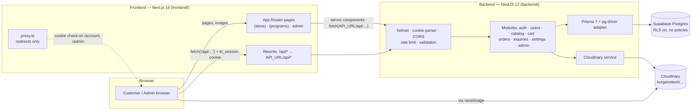
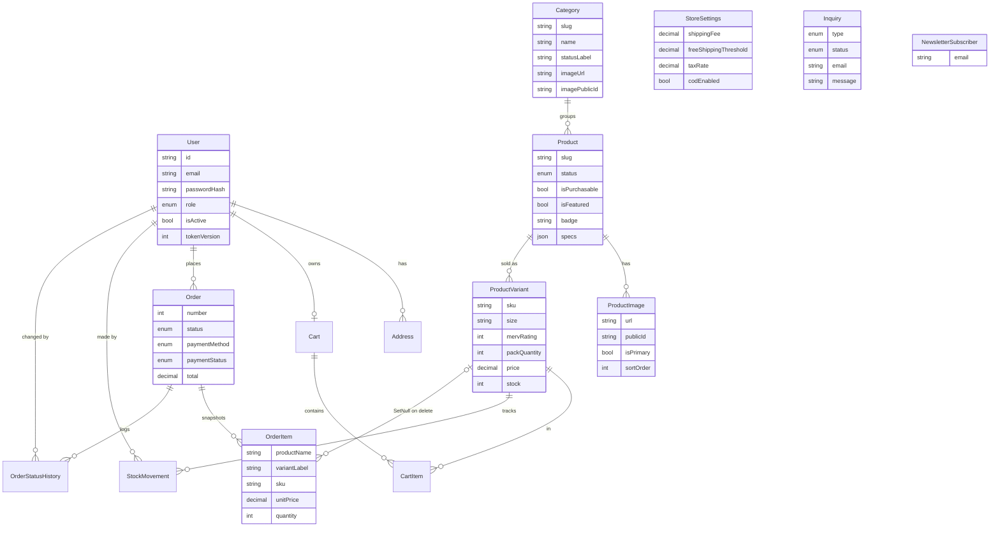
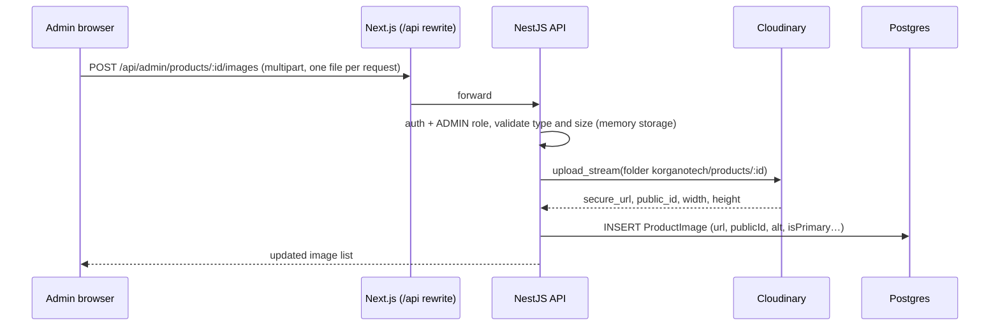
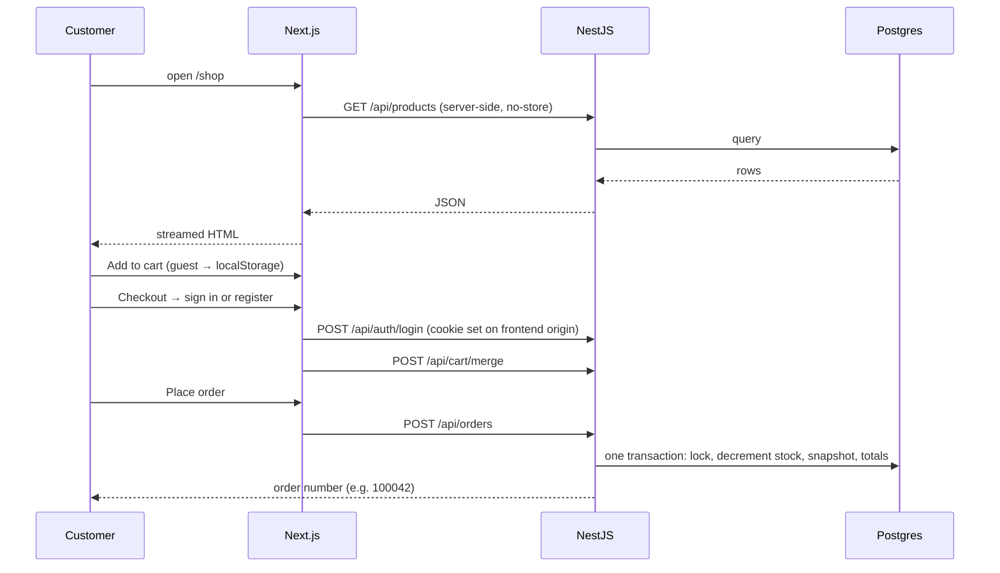
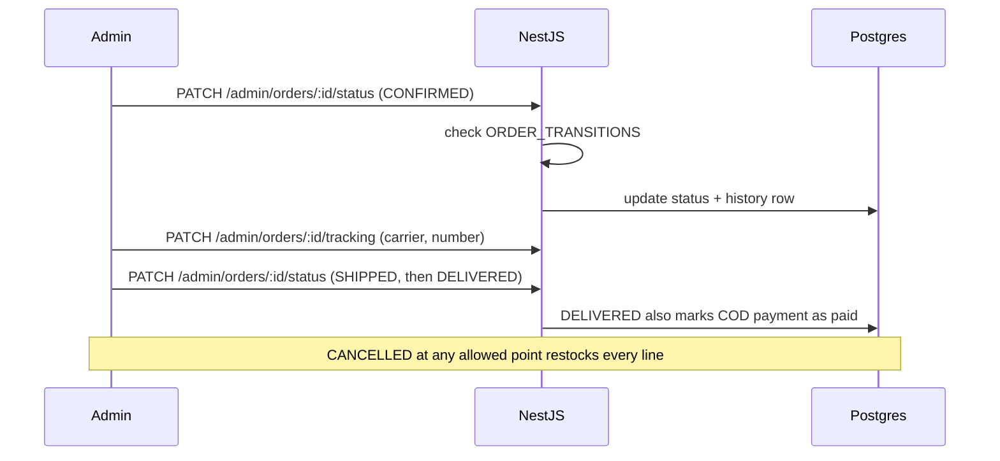

# KorganoTech — System Design

Architecture, data model, key flows, image handling and a Vercel deployment assessment for the KorganoTech store and admin dashboard.

Last reviewed: 2026-10-17 · Code reviewed: `main` at the time of writing (about 4,700 lines of backend TypeScript and 18,400 of frontend TypeScript).

---

## 1. What the system is

A full-stack e-commerce site for KorganoTech, a maker of MERV 11 / MERV 13 pleated HVAC air filters with two further programs under development (Pathogen and Environmental filtration).

| Capability | Status |
|---|---|
| Public storefront: home, shop with size and MERV filters, product pages, cart, checkout | Built |
| Three program pages (HVAC, Pathogen, Environmental) in one shared theme | Built |
| Company and info pages (About, Technology, Franchise, Resources, FAQ, Contact, policies) | Built |
| Customer accounts: register, login, addresses, order history with live status and tracking | Built |
| Admin dashboard: products, sizes and prices, stock, images, orders, customers, inquiries, settings | Built |
| Payment | **Cash on Delivery only.** The data model is ready for a gateway (Stripe is the likely choice) |
| Transactional email | Not built |

**Design goals that shaped the code:**
- One source of truth for money and stock: the backend, inside database transactions.
- Orders keep their own snapshot of what was sold, so catalog edits and deletes never rewrite history.
- The browser only ever talks to one origin, so the login cookie is first-party and CORS is not part of the normal path.
- The admin can run the whole business without a developer: prices, stock, images, copy for the three programs, shipping and tax.

---

## 2. System architecture



**Key idea:** two independent apps in one repository. They share no code and have no workspace tooling. Each has its own `package.json`, build and environment variables.

- **Frontend** renders pages. Server components call the API directly with `API_URL`. Browser code calls `/api/*` on its *own* origin, and a Next.js rewrite forwards it to the backend. That is why the `kt_session` httpOnly cookie is first-party in development and production.
- **Backend** is the only component that touches the database or Cloudinary. It authenticates and authorizes every request itself.
- **`proxy.ts`** (Next.js 16's replacement for middleware) only does fast UX redirects for signed-out visitors and non-admins. It decodes the role from the JWT *without verifying the signature*; real authorization is always in the API.

---

## 3. Technology stack

| Layer | Technology | Notes |
|---|---|---|
| Frontend framework | Next.js 16.4, React 19.3 | App Router, Cache Components + partial prerendering (`cacheComponents`, `partialPrefetching`) |
| Styling | Tailwind v4, shadcn/ui on Base UI | Base UI uses `render` instead of `asChild`; menu group parts must sit inside a group |
| Client state | TanStack Query 5, zustand 5 | Query for server data; zustand (persisted) for the guest cart |
| Forms and validation | react-hook-form, zod | |
| Charts / motion | recharts, motion | Admin dashboard charts; hero and Environmental page animation |
| Backend framework | NestJS 12 (ESM) | `"type": "module"`, relative imports end in `.js` |
| ORM / DB | Prisma 7.10 with `@prisma/adapter-pg`, Supabase Postgres | Generated client lives in `backend/src/generated/prisma` (git-ignored, built by `postinstall`) |
| Auth | JWT in httpOnly cookie, `bcryptjs` (cost 12) | |
| Images | Cloudinary (`cloudinary` v2, `multer` memory storage) | |
| Hardening | `helmet`, `class-validator` (whitelist + forbid unknown), in-house rate limiter | `@nestjs/throttler` was removed; see section 11 |
| Tests | Vitest | 11 unit tests (money and formatting); one e2e spec |

---

## 4. Repository layout

```
KorganoTec/
├── README.md                  # setup and how-it-works (developer quick start)
├── design.md                  # this document
├── frontend/
│   ├── next.config.ts         # /api rewrite, Cloudinary + Unsplash image hosts
│   └── src/
│       ├── proxy.ts           # redirects for /account and /admin
│       ├── app/
│       │   ├── layout.tsx     # root: fonts, Providers
│       │   ├── (store)/       # storefront shell: header, footer, cart drawer
│       │   ├── (programs)/    # hvac / pathogen / environmental, shared .theme-env
│       │   └── admin/         # admin shell and 9 sections
│       ├── components/        # ui, site, home, shop, product, account, admin, program…
│       ├── hooks/             # use-auth, use-cart, use-store-data, use-hydrated
│       └── lib/               # api.ts (server), client-api.ts (browser), cart-store.ts,
│                              # site.ts and env-data.ts (static copy), types
└── backend/
    ├── api/index.js           # the Vercel Function (serves the whole API)
    ├── vercel.json            # Vercel build, region, rewrite to /api
    ├── public/                # placeholder static folder for Vercel
    ├── prisma/                # schema.prisma, migrations, seed.ts, seed-assets/
    ├── prisma.config.ts       # DATABASE_URL for the Prisma CLI
    └── src/
        ├── main.ts            # local / server entry: listens on a port
        ├── vercel.ts          # Vercel entry: builds the app without listening
        ├── app.setup.ts       # shared setup: prefix /api, helmet, cookies, CORS, pipes
        ├── app.module.ts
        ├── auth/  users/  catalog/  cart/  orders/  inquiries/  settings/
        ├── admin/             # products, orders, inventory, customers, dashboard, content
        ├── cloudinary/  prisma/  health/
        └── common/            # guards, decorators, DTO helpers, money + format utils
```

---

## 5. Backend design

### 5.1 Request pipeline

Every request, in order:

1. **`helmet`**: security headers.
2. **`cookie-parser`**: reads `kt_session`.
3. **CORS**: allows the origins in `FRONTEND_URL` with credentials. In the normal path the browser never calls the API cross-origin, so this is a safety net.
4. **Global prefix** `/api`.
5. **`RateLimitGuard`** (global): 300 requests per minute per client IP and route by default. Routes narrow it with `@RateLimit({ limit, ttl })`: login and register 10 per 10 minutes, contact forms and newsletter 5 per 10 minutes, placing an order 10 per minute. Counters are in memory, so the limit is per server instance.
6. **`ValidationPipe`**: `whitelist` and `forbidNonWhitelisted`, so unknown fields are rejected, not ignored.
7. **Route guards**: `JwtAuthGuard` for signed-in routes, plus `RolesGuard` with `@Roles('ADMIN')` for the admin controllers.
8. **Controller → service → Prisma.**
9. **`DecimalInterceptor`**: converts Prisma `Decimal` values to plain numbers (already rounded to cents), so the frontend never parses money strings.

### 5.2 Modules and endpoints

All paths are under `/api`.

| Module | Endpoints | Access |
|---|---|---|
| `auth` | `POST register`, `POST login`, `POST logout`, `GET me`, `GET session` | Public, except logout and me |
| `users` (`/account`) | `PATCH profile`, `POST password`, `GET/POST/PATCH/DELETE addresses` | Signed in |
| `catalog` | `GET categories`, `categories/:slug`, `products`, `products/sizes`, `products/:slug` | Public |
| `cart` | `POST quote` (public, prices guest carts); `GET /`, `POST items`, `PATCH/DELETE items/:id`, `DELETE /`, `POST merge` | Quote public; rest signed in |
| `orders` | `POST /`, `GET me`, `GET me/:number`, `POST me/:number/cancel` | Signed in |
| `inquiries` | `POST inquiries`, `POST newsletter` | Public, rate limited |
| `settings` | `GET store` (shipping, tax, COD switch, announcement) | Public |
| `health` | `GET /` runs `SELECT 1`; returns `503` with the reason if the database is unreachable | Public |
| `admin/*` | stats; products (CRUD, images, variants, bulk generate); images; variants; inventory (adjust, movements); orders (list, detail, status, payment, tracking); customers; categories (+ image); inquiries; newsletter; settings | `ADMIN` only |

### 5.3 Authentication and sessions

- **Register / login** return a signed JWT set as an httpOnly cookie `kt_session`: `SameSite=Lax`, `Secure` when `NODE_ENV=production`, path `/`, lifetime `JWT_EXPIRES_IN_DAYS`.
- **JWT payload:** `sub` (user id), `role`, `tv` (token version).
- **On every protected request** `JwtAuthGuard` verifies the token *and* re-reads the user row. A token is rejected if the account is deactivated, the role changed, or `tokenVersion` no longer matches. **Logout bumps `tokenVersion`**, which revokes every outstanding token for that user immediately.
- **Passwords:** bcrypt cost 12. Login compares against a dummy hash when the email is unknown, so response time does not reveal whether an account exists.
- A `Bearer` header is also accepted (useful for tools); the browser uses the cookie.

### 5.4 Orders, stock and money

`POST /orders` runs **one database transaction**:

1. Load the signed-in user's cart with variants, products and primary images.
2. Re-check every line is still purchasable (variant active, product `ACTIVE` and `isPurchasable`).
3. Lock lines in a consistent order (sorted by variant id) to avoid deadlocks between simultaneous checkouts.
4. **Decrement stock only if enough remains**: `updateMany where stock >= quantity`. If nothing updates, the order fails with a clear message ("Only N left" / "just sold out").
5. Create the order with **snapshots** on each line: product name, slug, variant label, SKU, image URL, unit price, quantity, line total.
6. Compute totals from the live `StoreSettings` (shipping fee, free-shipping threshold, tax rate), rounded half-up to cents.
7. Write `StockMovement` rows (reason `ORDER`) and the first `OrderStatusHistory` row.

Later changes go through allowed transitions only:

```
PENDING → CONFIRMED → PROCESSING → SHIPPED → DELIVERED
   └────────┴────────────┴──→ CANCELLED   (allowed until shipped; restocks every line)
```

Marking an order delivered sets the COD payment to paid.

### 5.5 Other behaviour worth knowing

- **Product deletion is permanent.** It removes the product, its variants and images, and destroys the Cloudinary files. Past orders are unaffected because order lines keep their own snapshot (`variantId` becomes null; `productId` is a plain column).
- **Inventory** changes are always recorded as stock movements with a reason (`ORDER`, `CANCEL`, `ADJUSTMENT`, `RESTOCK`).
- **Settings** is a single-row table (`id = 1`).
- **Swagger** docs at `/api/docs` are served only when `NODE_ENV` is not `production`.
- **Two entry points, one setup.** `src/main.ts` starts a normal server (`app.listen`) for local development and traditional hosting. `src/vercel.ts` builds the same app *without* listening and exposes it as a request handler for Vercel. Both call `configureApp()` in `src/app.setup.ts`, so behaviour is identical.
- **Start-up:** the app does not wait for the database. It connects in the background; a failure is logged and shows on `/api/health`.

---

## 6. Data model



**Design notes**
- **Catalog shape:** `Category` is one of the three programs (`hvac`, `pathogen`, `environmental`). A `Product` has many `ProductVariant`s. Each variant is one **size × MERV rating × pack quantity** with its own SKU, price, compare-at price, stock and low-stock threshold. The combination is unique per product.
- **Order numbers** are human-friendly integers starting at 100001 (a database sequence).
- **Deletes cascade down the catalog:** deleting a product removes its images and variants, and carts lose those lines. A category cannot be deleted while it has products (`Restrict`).
- **Order history survives** because `OrderItem` carries its own copy of every displayed value.
- **Row Level Security** is enabled on every table with no policies, and grants are revoked from Supabase's `anon` and `authenticated` roles. Supabase's public REST endpoint therefore cannot read store data. Only the backend (connecting as `postgres`) can.
- **Inquiries** cover Contact Sales, Franchise, "Notify me" product interest and General; each has a status (New, Read, Archived).

---

## 7. Frontend design

### 7.1 Routes

| Group | Routes |
|---|---|
| `(store)` shell | `/`, `/shop`, `/shop/sizes`, `/products/[slug]`, `/cart`, `/checkout`, `/order-confirmation/[number]`, `/login`, `/register`, `/account` (profile, addresses, orders, order detail, settings), `/about`, `/technology`, `/franchise`, `/resources` and `/resources/[slug]`, `/faq`, `/contact`, `/privacy`, `/terms`, `/shipping-returns` |
| `(programs)` shared theme | `/hvac-air-filters`, `/pathogen-air-filters`, `/environmental-air-filters` |
| `admin` | `/admin` (dashboard), `orders` (+ detail), `products` (+ new, edit), `inventory`, `categories`, `customers` (+ detail), `inquiries`, `newsletter`, `settings` |

### 7.2 How data reaches the screen

| Where | Mechanism | Used for |
|---|---|---|
| Server components | `serverGet()` in `lib/api.ts`: `fetch(API_URL/api/…, { cache: "no-store" })` inside `<Suspense>` | Shop list and product pages, so price and stock are always current |
| Browser | `api()` in `lib/client-api.ts` → `/api/*` (same origin, rewritten to the backend) wrapped in TanStack Query | Session, cart, account, checkout, entire admin |
| Static content | TypeScript modules: `lib/site.ts` (copy from korganotech.com), `lib/env-data.ts`, `lib/resources.ts` | Program pages, About, Resources articles, FAQ |

Next.js 16 Cache Components means the static parts of a page are prerendered and the dynamic parts stream in. Anything that reads the request or time (`usePathname`, `useSearchParams`, `params`) must sit inside `<Suspense>`, and prerendered server components must not call `new Date()`.

### 7.3 Cart and checkout

- **Guests** keep their cart in a persisted zustand store (localStorage) as lines of `{ variantId, quantity }`. The API prices it through the public `POST /cart/quote`.
- **On sign-in** the guest lines are sent to `POST /cart/merge` and folded into the account cart.
- **Checkout requires an account** (shoppers can register on the checkout page). It supports a saved address or a new one, and places the order with Cash on Delivery.
- Anything that depends on the session or browser storage is gated by `useHydrated()` to avoid server/client mismatches.

### 7.4 Admin dashboard

A client-rendered shell (sidebar with live badges for pending orders, low stock and new inquiries) that talks to `/api/admin/*`.

| Section | Highlights |
|---|---|
| Dashboard | Sales, cash collected, orders by status, 30-day charts, low stock, top products |
| Orders | Search and filter; confirm, ship (carrier and tracking), deliver, cancel; payment status |
| Products | Create (with images), edit, delete with confirmation; upload, reorder and set primary image; sizes, prices and stock; bulk size × MERV × pack generator |
| Inventory | Adjust stock with a reason; movement history per variant |
| Categories | Copy and images for the three programs |
| Customers | Orders, spend, addresses; deactivate or grant admin |
| Inquiries, Newsletter | Triage; CSV export |
| Settings | Shipping fee, free-shipping threshold, tax rate, COD switch, announcement bar |

### 7.5 Look and feel

- Plus Jakarta Sans and a violet brand palette for the main store.
- The three program pages share a `.theme-env` scope (Bricolage Grotesque, Fraunces and IBM Plex), a port of the Environmental Filters site, with HVAC and Pathogen rebuilt in the same style.
- The home hero is sized to the viewport below the header using the `--header-h` CSS variable and `svh` units, so the whole hero is visible without scrolling.

---

## 8. Image handling with Cloudinary

**Cloudinary is fully integrated and is the single home for product and category images.** Nothing is stored on the app servers' disks, so the setup suits serverless hosting.

### 8.1 Upload flow



- **Limits:** JPG, PNG, WebP or AVIF, **4 MB** per file, validated in the API (kept under Vercel's roughly 4.5 MB request-body limit).
- **Primary image:** the first image uploaded becomes primary; the admin can change it or reorder images later.
- **New product page:** the admin can pick images while creating a product. The product is created first, then each file is uploaded to it.
- **Storage in the database:** `ProductImage.url` (Cloudinary `secure_url`) and `ProductImage.publicId` (for deletion). Categories carry `imageUrl` and `imagePublicId`.
- **Deleting** an image or a product also destroys the Cloudinary file. Deletion is best effort: a Cloudinary failure is logged and does not block the admin.
- **Seed data:** the seed script uploads its placeholder photos to Cloudinary too, so seeded and admin-uploaded images behave identically.
- **Order lines** copy the image URL at purchase time, so an order still shows its picture after the product changes.

### 8.2 Delivery

The storefront renders images through `next/image` (`ProductImage` component) with the Cloudinary URL as the source. `next.config.ts` allows only these hosts:

| Host | Pattern |
|---|---|
| Cloudinary | `res.cloudinary.com`, path `/dmaf8fdeu/**` |
| Unsplash (Environmental page photography) | `images.unsplash.com`, any path |

**Coupling to be aware of:** the frontend must know the Cloudinary cloud name to allow its images. It reads `NEXT_PUBLIC_CLOUDINARY_CLOUD_NAME` (default `dmaf8fdeu`). If the Cloudinary account ever changes, set it to the same value as the backend's `CLOUDINARY_CLOUD_NAME`, or images will not load.

### 8.3 Recommendations

- Add `f_auto,q_auto` to Cloudinary delivery URLs (or use a Cloudinary loader for `next/image`) so Cloudinary does the format and quality work instead of Vercel's image optimizer doing it a second time. This lowers image-optimization usage on Vercel.
- If larger images are ever needed, switch to **signed direct-to-Cloudinary uploads** from the browser (Vercel's body limit then no longer applies). The API would only issue a signature and save the returned URL.

---

## 9. Key flows

### 9.1 Browse and buy



### 9.2 Admin updates stock and fulfils an order



---

## 10. Deploying on Vercel

### 10.1 Verdict

| Part | Verdict |
|---|---|
| **Frontend (Next.js 16)** | **Yes, natively.** No changes are needed. It builds even when the backend is unreachable. |
| **Backend (NestJS 12)** | **Yes.** It is packaged as one Vercel Function using Vercel's standard `api/` function format (section 10.2). This was tested locally, but its first deployment on Vercel is still to be confirmed (section 10.6). |
| **Images** | **Yes.** Cloudinary is external, so nothing depends on the server's disk. |
| **Database** | **Yes.** Supabase is external, reached over the network. |

### 10.2 How the backend is packaged for Vercel

Earlier attempts used Vercel's NestJS auto-detection, which runs `main.ts` and waits for it to listen. That produced a 60-second hang with no log output. The backend now uses Vercel's long-established function format instead, which does not depend on that detection:

| File (all under `backend/`) | Role |
|---|---|
| `vercel.json` | `framework: null` (Vercel's "Other"), `npm run build`, output folder `public`, region `bom1` (Mumbai, next to Supabase), function `maxDuration` 30 s, and a rewrite that sends every path to `/api` |
| `api/index.js` | The one Vercel Function. Imports the compiled app, builds it on the first request of each instance, then reuses it while warm. A failed build is not cached, so the next request retries |
| `src/vercel.ts` → `dist/vercel.js` | `createApp()`: creates the Nest app without `listen()` and returns its Express handler |
| `src/app.setup.ts` | `configureApp()`: prefix `/api`, helmet, cookies, CORS, validation. Shared with `main.ts` |
| `public/robots.txt` | Placeholder static folder, so Vercel does not treat the project root as static files. Disallows crawlers |
| `.vercelignore` | Leaves out `test/` and the seed images |
| `package.json` → `engines.node` | Pins Node 24.x |

**Verified locally** on a clean install and build, with the handler served by a plain Node server and Node's `require()`-of-ES-modules switched off (the setting that previously reproduced Vercel's crash):

- cold start about 2.6 s, then roughly 0.1 s per request;
- `/api/health` reports the database connected;
- admin login sets a `Secure; HttpOnly; SameSite=Lax` cookie, `/auth/me` and admin routes work, and admin routes return 401 without it;
- creating a product, uploading an image to Cloudinary, and deleting the product all work;
- a 5 MB image is rejected with 413;
- Swagger is hidden when `NODE_ENV=production`.

### 10.3 Recommended topology

Two Vercel projects from the one GitHub repository:

| Project | Root Directory | Framework Preset | Public address (as deployed) |
|---|---|---|---|
| Backend | `backend` | **Other** | `https://korgano-tech.vercel.app` |
| Frontend | `frontend` | Next.js | `https://korgano-tech-web.vercel.app` |

The frontend reaches the backend through `API_URL`. Because `next.config.ts` reads it when the site is built, changing it requires a redeploy of the frontend.

### 10.4 Environment variables

Values are not recorded in this repository. Real values live in each Vercel project's **Settings → Environments → Production** page and, for local work, in git-ignored `.env` files.

**Backend project**

| Name | Required | Value / where it comes from |
|---|---|---|
| `NODE_ENV` | Yes | `production`. Turns on `Secure` cookies and disables Swagger. |
| `DATABASE_URL` | Yes | Supabase **Transaction pooler** string (port 6543, host ending `.pooler.supabase.com`). URL-encode special characters in the password. No quotation marks. |
| `JWT_SECRET` | Yes | A new random string of 32+ characters, different from local development. |
| `JWT_EXPIRES_IN_DAYS` | Yes | `7` |
| `CLOUDINARY_CLOUD_NAME`, `CLOUDINARY_API_KEY`, `CLOUDINARY_API_SECRET` | Yes | From the Cloudinary console. |
| `FRONTEND_URL` | Yes | The frontend's address, no trailing slash. |
| `DB_POOL_MAX` | No | Connections per instance. Default 3 on Vercel, 10 elsewhere. |
| `TRUST_PROXY_HOPS` | No | Number of proxies in front of the API. Default 1. See the client-IP note below. |

`PORT` and `VERCEL` are set by Vercel. `ADMIN_EMAIL` and `ADMIN_PASSWORD` are only read by the seed script, which runs from a developer machine.

**Frontend project**

| Name | Required | Value |
|---|---|---|
| `API_URL` | Yes | The backend's production address, `https://` and no trailing slash. |
| `NEXT_PUBLIC_SITE_URL` | Yes | The frontend's own address. |
| `NEXT_PUBLIC_CLOUDINARY_CLOUD_NAME` | No | Defaults to `dmaf8fdeu`. Set it only if the Cloudinary account changes. |

### 10.5 Compatibility checklist

| Concern | Status | Detail |
|---|---|---|
| Next.js 16 on Vercel | OK | First-class support. |
| ES-module-only NestJS 12 | Fixed | `@nestjs/throttler` (CommonJS) `require()`d `@nestjs/common` (ESM-only), which Vercel's runtime refuses. Replaced by a small built-in rate limiter. |
| TypeScript typing of `helmet` | Fixed | Vercel's build read different type definitions than a local machine; the import compiles with either. |
| Start-up | Fixed | The function does not listen; the database connects in the background; `/api/health` reports failures with a reason. |
| Database connections | Handled | Transaction pooler (6543); small pool per instance; 10 s connect timeout. Prisma's driver uses unnamed statements, which suit transaction mode. Checkout's interactive transaction works in this mode. |
| Request body size | Fixed | Image limit lowered from 5 MB to 4 MB, below Vercel's roughly 4.5 MB request cap. |
| Function region | Set | `bom1` in `vercel.json`, next to Supabase in Mumbai. |
| Rate limiting | Weaker than on a server | Counters live in each instance's memory, so limits are per instance, not global. |
| Client IP behind two Vercel hops | **To verify after deployment** | With the frontend forwarding to the backend, the backend may see the frontend's address instead of the visitor's, so visitors could share one rate-limit bucket (10 logins per 10 minutes in total). `TRUST_PROXY_HOPS` lets this be tuned without a code change; if it persists, pass the visitor IP in a header. |
| Long-lived features | None used | No WebSockets, cron jobs, background workers or local file writes. |
| Stripe later | Feasible | A webhook endpoint on the backend. It needs the raw request body for signature checks. |

### 10.6 Status and what to confirm after deploying

History of the first backend deployment attempts: build failed on `helmet` typing (fixed); crash from `@nestjs/throttler` (fixed); then a 60-second hang under Vercel's NestJS auto-detection (replaced by the function format above).

After deploying this version, open `https://<backend address>/api/health`:

- `{"status":"ok","database":"connected"}`: the backend works.
- `503` with `"database":"unreachable"` and a reason: fix `DATABASE_URL` (no quotes; transaction pooler host and port; current encoded password). If the transaction pooler itself is the problem, use the 5432 string temporarily.
- A Vercel error page: open the deployment's **Logs** and read the message; the function now fails loudly at load time instead of hanging.

### 10.7 Fallback if the backend cannot be made reliable on Vercel

Host the **backend only** on a platform that runs a normal long-lived Node server (Railway, Render or Fly.io). Keep the frontend on Vercel. Changes needed:

- Set the frontend's `API_URL` to the new backend address, and the backend's `FRONTEND_URL` to the frontend address.
- No code changes: `npm run build` then `node dist/main` runs the same app via `main.ts`, with exact rate limits and no body-size cap.

### 10.8 Plan, cost and domain

- Vercel's free Hobby plan is for non-commercial use. A client-facing business site should be on **Pro** before real selling begins.
- Buy the domain later (Vercel Domains or any registrar), add it under the frontend project's **Settings → Domains**, then update `NEXT_PUBLIC_SITE_URL` (frontend) and `FRONTEND_URL` (backend) and redeploy both.
- Keep **Deployment Protection** on its default ("Standard Protection"). It protects the long per-deployment addresses and leaves the main production addresses public. Always use the main production addresses, not the per-deployment ones.

---

## 11. Security model

| Area | Measure |
|---|---|
| Sessions | httpOnly, `SameSite=Lax`, `Secure` in production; revocable via `tokenVersion`; user row re-checked every request |
| Passwords | bcrypt cost 12; constant-time-style login for unknown emails |
| Authorization | Enforced in the API (`JwtAuthGuard`, `RolesGuard`); `proxy.ts` is UX only |
| Input | Whitelisting validation; unknown fields rejected; file type and size checked before upload |
| Abuse | Global 300 requests per minute; stricter limits on login, register, forms and orders |
| Headers | `helmet` defaults |
| Data exposure | Supabase RLS on all tables, no policies, anon grants revoked, so only the backend can read data |
| Secrets | Only in git-ignored `.env` files and Vercel project settings; `.env.example` holds names only |
| Money integrity | All totals computed server-side with decimal arithmetic; stock decremented conditionally inside a transaction |

**Housekeeping:** credentials were pasted into a chat during development. Rotate the Supabase password and the Cloudinary secret, generate a fresh `JWT_SECRET` for production, and change the seeded admin password after first login (**My account → password**).

---

## 12. Known limitations and suggested next steps

| Item | Why it matters | Suggested action |
|---|---|---|
| New backend packaging not yet confirmed on Vercel | Blocks the live demo until it answers | Deploy and follow section 10.6; use the fallback in 10.7 if needed |
| Image limit is 4 MB | Larger originals must be resized before upload | Resize in the admin's browser, or add signed direct-to-Cloudinary uploads |
| Rate limiter is per instance | Weaker abuse protection on serverless | Acceptable now; move counters to a shared store if abuse appears |
| Visitor IP behind two proxies | Possible shared rate-limit bucket | Verify after deployment and adjust `TRUST_PROXY_HOPS` (10.5) |
| Cloud name must match in two places | Images break if the frontend and backend disagree | Keep `NEXT_PUBLIC_CLOUDINARY_CLOUD_NAME` equal to `CLOUDINARY_CLOUD_NAME` |
| Online payments | COD only | Add Stripe (needs keys, webhook secret and business details) |
| Transactional email | No order or password-reset emails | Add a provider such as Resend |
| Placeholder content | Prices, stock and policy pages are seed data and templates | Client to supply real data and review policies |
| Local e2e spec | `test/app.e2e-spec.ts` lacks `supertest` typings | Add the types or drop the spec |
| `pg` deprecation warning | "client.query() while already executing a query" appears in logs | Harmless today; re-check on `pg` upgrade |

---

## 13. Working with the project

| Task | Command |
|---|---|
| Backend dev | `cd backend && npm install && npm run start:dev` (port 3001) |
| Frontend dev | `cd frontend && npm install && npm run dev` (port 3000) |
| Apply migrations | `npm run db:deploy` (production) or `npm run db:migrate` (development) |
| Seed | `npm run db:seed` (idempotent: categories, products, sizes, settings, admin) |
| Backend tests | `npm test` in `backend/` |
| Frontend lint / build | `npm run lint`, `npm run build` in `frontend/` |

Notes:
- Run migrations and the seed from a developer machine against the **session pooler or direct** connection (port 5432), not the transaction pooler.
- `next build` and `next dev` share the `.next` folder; restart the dev server after a production build.
- API docs while developing: `http://localhost:3001/api/docs`.
- The README holds the longer setup walk-through; this document describes how the pieces fit together.
